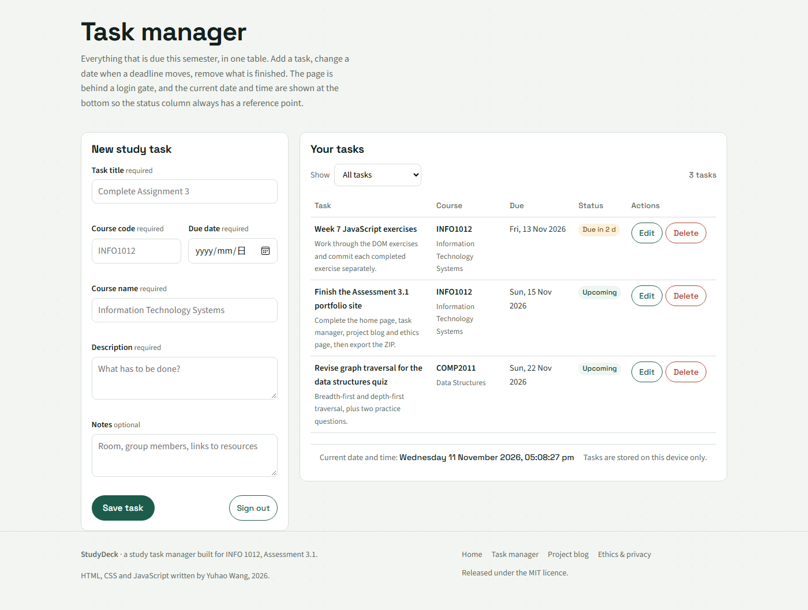

# StudyDeck — My Study Task Manager

A small, single-purpose web application that keeps every assignment, revision
block, quiz and deadline for a semester in one place, sorted by the date it is
actually due.

**Repository:** <https://github.com/wangyuhao123453/Assignment3.1_StudyDeck>

Built as **INFO 1012 Assessment 3.1 (Web Page Development Portfolio)** by
**Yuhao Wang** (student ID 2518040121), using HTML, CSS, JavaScript and Markdown
in Visual Studio Code.



## Project description

Students usually track their work across a notebook, a spreadsheet, a chat
history and a course page, and the deadlines end up in none of them. StudyDeck
puts the list back in one predictable place:

- every task stores a **title, course code, course name, due date, description
  and optional notes**;
- the table is **sorted by due date**, so the next thing to do is always on top;
- each row shows a **status badge** — upcoming, due within three days, or overdue —
  calculated from the real current date rather than typed in by hand;
- the list **survives closing the browser**, because tasks are written to
  `localStorage` on the device that created them.

The application has four pages: a home page that explains the app and introduces
the author, the task manager itself, a project plan and troubleshooting blog, and
an ethics and privacy reflection.

## Features

| Area | What it does |
| --- | --- |
| Login gate | The task list is hidden until the correct username and password are entered; the session ends when the tab closes. |
| Create | Adds a task with title, course code, course name, due date, description and notes. |
| Update | Re-opens an existing task in the form, allows any field to be changed, then saves the changes back into the list. |
| Delete | Removes a task **only after a confirmation dialog**; cancelling leaves the task untouched. |
| View | A sortable-by-date table with course, due date, status badge and per-row actions. |
| Filter | Shows all tasks, tasks not yet due, tasks due within three days, or overdue tasks. |
| Validation | Rejects empty required fields, malformed course codes, impossible dates and past due dates, with a message next to the field that needs attention. |
| Clock | The current date and time are displayed at the bottom of the task page and update every second. |
| Image carousel | The home page shows three study images and cycles them with a button. |

## How to install and run

No build step, no dependencies, no server required.

1. Download the ZIP file and extract it to any folder.
2. Open the folder. The site is the set of `.html` files at the top level.
3. Double-click **`index.html`** to open it in a browser. Chrome, Edge, Firefox
   and Safari all work.

Optional — run it from a local web server instead of `file://`:

```bash
# from inside the extracted folder
python -m http.server 8000
# then open http://localhost:8000
```

If the project is pushed to GitHub, it also runs directly from **GitHub Pages**
with no extra configuration, as long as Pages is set to deploy from the branch
root.

## How to use the application

### 1. Open the home page

Start at `index.html`. It explains what the application does, who built it, and
lets you cycle the three study images with the **Change image** button (the three
small dots underneath jump straight to a particular image).

### 2. Sign in

Open **Task manager** from the navigation. The task list is behind a login gate.

- Username: `yuhao`
- Password: `study2026`

Wrong details produce a plain error message and empty the password field. The
sign-in is remembered in this tab only, so closing the tab locks the list again.
**Sign out** is always available while the list is open.

### 3. Add a task

Fill in the form on the left:

1. **Task title** — at least 3 characters, for example `Complete Assignment 3`.
2. **Course code** — four letters followed by four digits, for example `INFO1012`.
3. **Due date** — pick it with the date picker; today and any later date are
   accepted, a past date is rejected.
4. **Course name** — for example `Information Technology Systems`.
5. **Description** — what actually has to be done.
6. **Notes** — optional: room, group members, links.

Press **Save task**. The task appears in the table on the right, sorted into its
place by due date, with a status badge.

### 4. Update a task

Press **Edit** on the row you want to change. The form switches to *Edit study
task*, is filled with the task's current values, and **Save changes** writes the
update back. **Cancel edit** leaves the task exactly as it was.

### 5. Delete a task

Press **Delete** on the row. A confirmation dialog names the task and warns that
the change cannot be undone. Confirm to remove it, cancel to keep it.

### 6. Filter the list

Use the **Show** menu above the table to switch between all tasks, tasks not yet
due, tasks due within three days, and overdue tasks. The counter on the right
always reports how many tasks the current filter is showing.

### 7. Read the project pages

- **Project blog** — the three-week sprint plan in a table, the Agile research
  behind it, and two documented bugs with screenshots, the code that caused each
  one and the corrected code.
- **Ethics & privacy** — what the application collects, what it deliberately does
  not collect, and the known limits of the login gate.

## Repository structure

```
Assignment3.1_StudyDeck/
├── index.html          # home page: hero, image carousel, about the app, about me
├── tasks.html          # task manager: login gate, form, task table, live clock
├── blog.html           # project plan and troubleshooting blog
├── ethics.html         # ethics and privacy reflection
├── css/
│   ├── styles.css      # one stylesheet shared by all four pages
│   └── fonts/          # self-hosted woff2 files so the site works offline
├── js/
│   ├── auth.js         # the login gate
│   ├── tasks.js        # task data, validation, table rendering, clock
│   └── home.js         # the image carousel
├── images/             # study illustrations, portrait, favicon, page screenshots
│   └── blog/           # the four screenshots used by the blog page
├── README.md
└── LICENSE
```

HTML pages sit at the repository root so that the site opens straight from
`index.html`; CSS and JavaScript each have their own folder.

## Data and privacy

Tasks are stored in the browser's `localStorage` under the key
`studydeck.tasks.v1` and never leave the device. There is no account system, no
backend and no analytics. Clearing the browser's site data deletes the list.

The login gate is a **usability barrier, not real security** — it is checked in
`js/auth.js` in the browser, so anyone who reads the source can see the
credentials. The ethics page states this limitation openly.

## Credits

- **Code and content**: Yuhao Wang.
- **Typefaces**: Space Grotesk (Florian Karsten) and Source Sans 3 (Adobe), both
  licensed under the SIL Open Font License and bundled in `css/fonts/`.
- **Illustrations**: three study illustrations (`desk-study.jpg`, `planner.jpg`,
  `study-break.jpg`) generated for this project, plus the portrait
  `profile.jpg` supplied by the author.
- **Reading**: Flewelling, P. (2018) *The agile developer's handbook*, Packt —
  chapter 1 for the Agile research on the blog page.

## Licence

Released under the **MIT Licence** — see [LICENSE](LICENSE).

## Known limitations

- Tasks live in one browser on one device; there is no sync or export.
- Dates are stored as `YYYY-MM-DD` with no time of day, so a task due "today"
  stays open until the date changes.
- The login gate does not protect the data from someone with access to the
  browser profile on the same machine.
